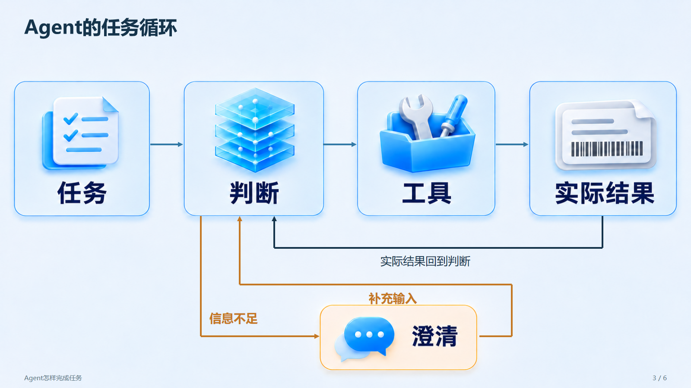

# TechTalk PPT Skill

制作技术分享PPT，支持整页生图与生成图文、原生元素混排。

An Agent Skill for AI-generated PowerPoint / PPTX technical presentations, with full-slide images and hybrid layouts.

[下载最新版本](https://github.com/sw897/tech-talk-ppt-skill/releases/latest) · [Skill入口](SKILL.md) · [生图样式与样图](assets/styles/tech-blue/style.md)

## 两种PPT制作模式

| 模式 | 制作方式 | 编辑范围 |
| --- | --- | --- |
| 整页生图 · Full-slide image | 将一页的图形与文字整体生成，装入PPTX | 图内内容通过修图修改，讲稿保留为原生备注 |
| 混合制作 · Hybrid | 组合生成图文、图内标注与原生文字、表格、连线 | 原生对象可直接编辑，图内内容通过修图修改 |

从技术文章、项目资料或现有大纲组织分享结构，配套讲稿与实际PPT渲染预览，支持按页修改标题、参数、备注或图片。精确数值、代码和复杂连接优先保留为原生元素。

## 技术分享PPT示例

[Agent任务循环](examples/agent-loop/README.md)是6页技术分享主示例，第3页结合图内生成标签与原生连接。以下为实际PPT导出：




[文件清单示例](examples/file-list/README.md)包含6页整页生图和10页混合制作，以及参数表、代码、改标题、改参数与备注、换图的示例。

生图样式见[近白技术蓝](assets/styles/tech-blue/style.md)，包含数据处理、服务架构和任务协作样图。

## 安装Skill

仓库根目录即Skill目录。可用[Skills CLI](https://skills.sh/docs/cli)安装：

```sh
npx skills add sw897/tech-talk-ppt-skill
```

也可从[Releases](https://github.com/sw897/tech-talk-ppt-skill/releases)下载ZIP包，解压后按目标Agent的Skill目录规范接入；`.skill`与ZIP内容相同。生图使用当前Agent提供的图像生成与编辑能力。

示例交办：

```text
使用tech-talk-ppt-skill，把这份技术资料做成分享PPT。
采用混合制作，保留讲稿，输出PPTX与预览。
```

首次使用装配脚本前，在Skill目录安装下述依赖。

## 本地运行示例

装配脚本需要Node.js 18+、Python 3.10+。克隆仓库后可用随包素材直接构建示例：

```sh
git clone https://github.com/sw897/tech-talk-ppt-skill.git
cd tech-talk-ppt-skill
npm ci --ignore-scripts --no-audit --no-fund
python -m pip install -r requirements.txt
node scripts/build_pptx.mjs --spec examples/agent-loop/hybrid.json --output outputs/agent-loop.pptx
```

Pillow仅用于审阅联系表。实际渲染需要PowerPoint／WPS，或LibreOffice与pdftoppm；字体按目标机器调整。已有大纲可直接进入逐页制作，局部修改说明目标页与保留项。

命令与数据格式见[PPT装配](references/pptx-assembly.md)。图像生成使用当前Agent内置能力，装配脚本只消费实际取得的图片。

## 运行环境与能力范围

提供静态PPTX装配、原生备注、受控局部修改和实际渲染。生图由Agent执行，脚本装配已有图片。复杂动画与任意旧PPT的完整重构需要单独处理。

## 许可

本项目采用[MIT许可](LICENSE)。第三方依赖、字体和外部软件的说明见[资源与依赖声明](THIRD_PARTY_NOTICES.md)。
