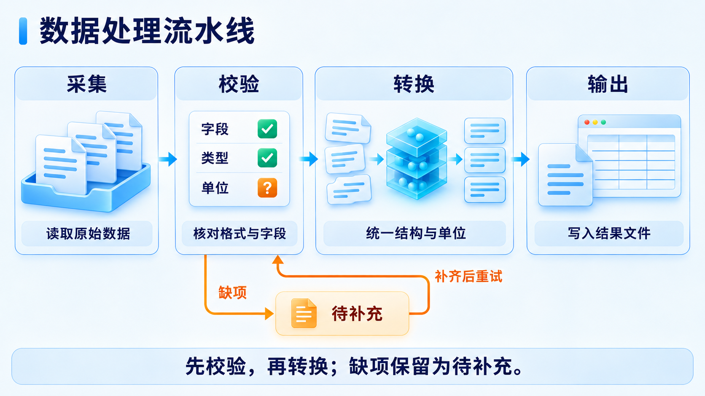
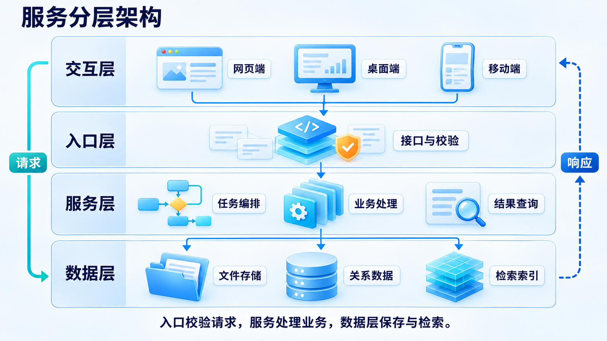
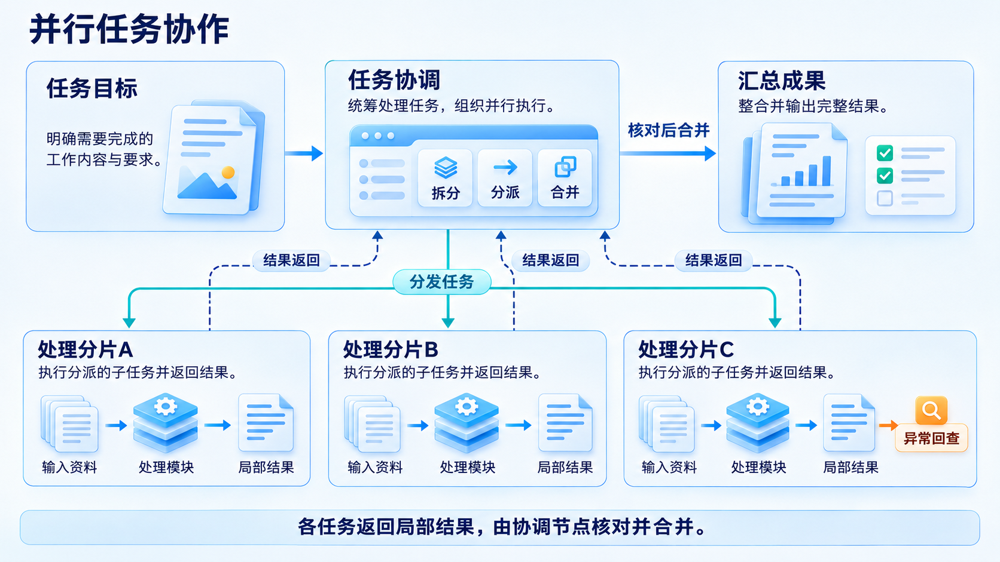

# 近白技术蓝

面向技术分享的视觉预设。近白空间、深蓝文字，浅蓝到中蓝与深蓝的自然层次，少量橙金强调；技术物件精细轻立体，文字与连接保持二维清楚。不用霓虹、背景电路、无意义齿轮或巨型机器人填空。

## 风格约束

整套采用相同字体角色、标题基线、边距和关系语义，各页按内容改变构图。默认1600×900，安全边56px，标题44px，正文28px，重要标签24—28px；这是此预设的起点，可按画幅和实际可读性换算。px按96dpi换为pt，44px约33pt。

保留技术蓝的实际明暗与适度通透感，不继续统一压暗、灰化或降饱和度。请求或执行可用青色实线，结果反馈用深蓝虚线，澄清与异常用橙金并标明条件；包含关系不画成执行箭头。

普通机制页让有意义图形和短标签共同解释关系。必要对象、条件和例子不能因追求留白被删掉；精确表格、代码与参数页可以原生信息为主。字号不足时重排、拆页或转换精确层，避免靠缩字容纳。

## 参考图职责

- [数据处理](palette-data-pipeline.png)：配色、物件质感、流程与异常回路。
- [服务架构](palette-service-layers.png)：近白空间、分层与请求响应。
- [任务协作](palette-task-collaboration.png)：技术蓝、并行分工与结果返回。

实际查看所选图，再附入生成请求。同批固定参考组。只借用视觉语言，不复制文字、字段、品牌、数量和技术结论。参考图职责与文件哈希见[清单](reference-manifest.json)。

三张样图分别展示流程、层级与协作关系。图内标题和标签为生成文字，实际PPT按内容选择整页生图或原生叠排，字号与布局不直接照搬。提示词与参考职责见[生成记录](generation-manifest.json)。

## 两种模式

整页生图：提示词明确整页画幅、完整逐字文案和区域层级；标题也属于生成图，交付不称为原生可编辑。

混合制作：稳定短标签可随主体生图，其他文字可原生叠排；精确数值、表格、代码和复杂连接优先原生。按最终容器规划图内文字、原生槽位与连接通道，避免重复叠字。

查看整页与1280×720缩小预览，并与参考并排检查。原生插图组合必须一起保留图像、裁切、连接、标签、层级及必要状态。
