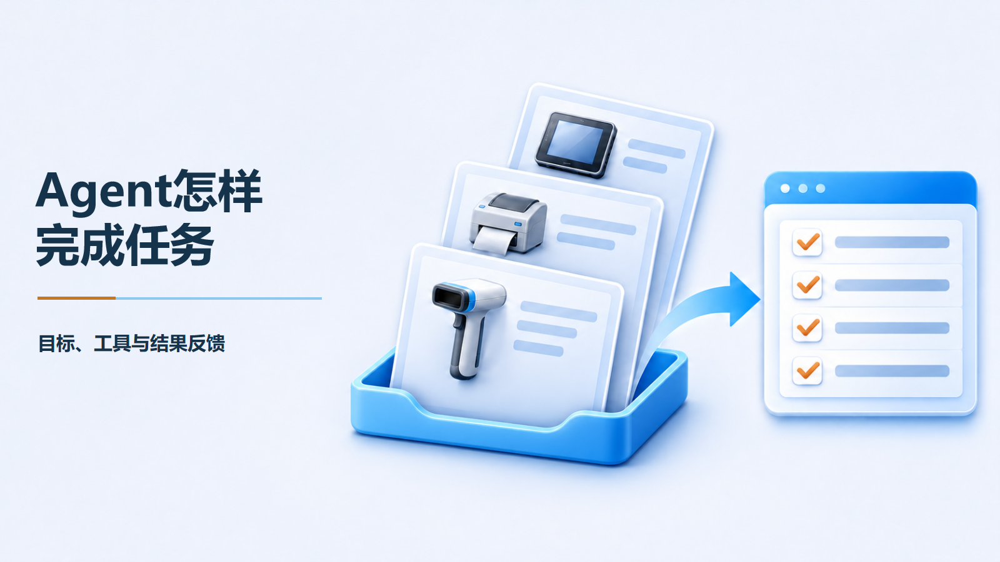
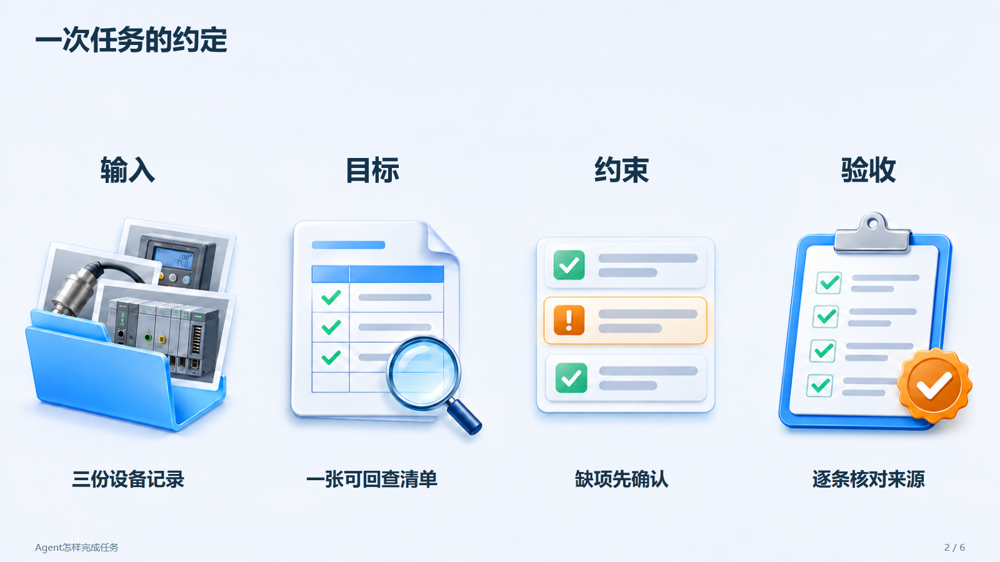
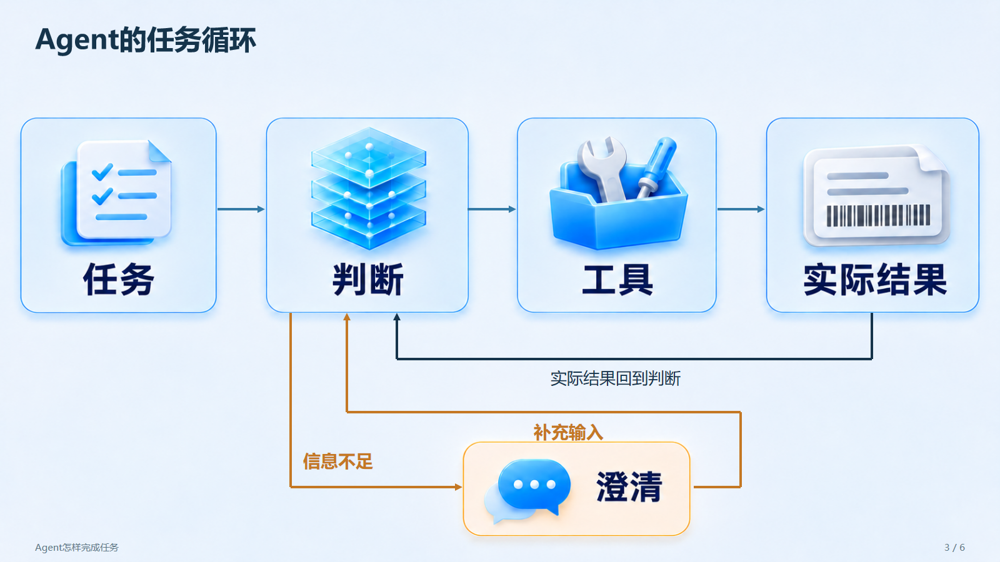
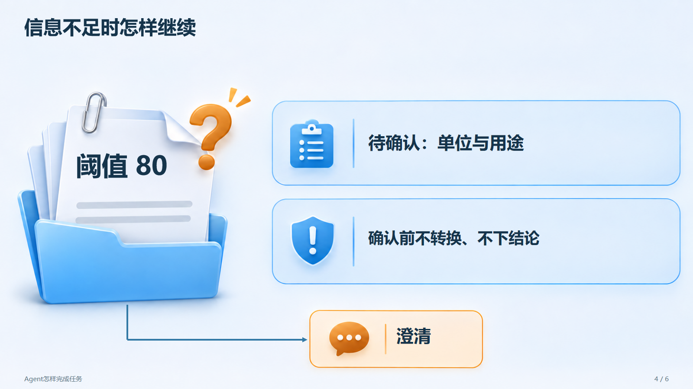
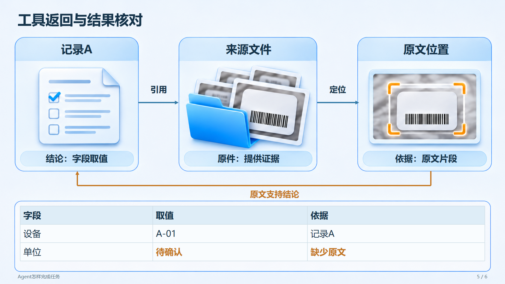
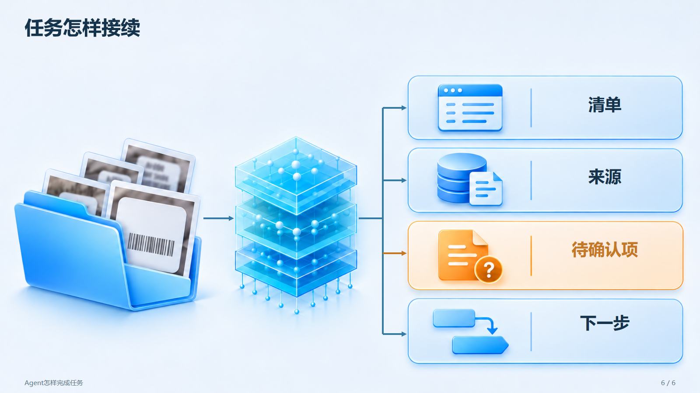

# Agent任务循环

完整6页技术分享示例，下面逐页展示实际PPT导出图。

[下载6页PPTX（含讲稿）](https://github.com/sw897/tech-talk-ppt-skill/releases/download/v1.0.1/agent-loop-example_V1.0.1.pptx)

所有页都有生成视觉；第3页的“任务、判断、工具、实际结果、澄清”随图生成，标题、箭头与分支说明为原生对象，第5页表格也可直接编辑。

## 第1页：Agent怎样完成任务



## 第2页：一次任务的约定



## 第3页：Agent的任务循环



## 第4页：信息不足时怎样继续



## 第5页：工具返回与结果核对



## 第6页：任务怎样接续



## 复现示例

在Skill目录安装依赖后运行：

```sh
node scripts/build_pptx.mjs --spec examples/agent-loop/hybrid.json --output outputs/agent-loop.pptx
python scripts/render_pptx.py outputs/agent-loop.pptx --output-dir outputs/agent-loop-render --backend auto
python scripts/review.py outputs/agent-loop.pptx --images outputs/agent-loop-render --output outputs/agent-loop-review.html
```

[讲述材料](source.md)与[逐页计划](hybrid.json)一同保存。示例资料为合成内容，机制讲解不代表真实业务执行。图像哈希、参考职责与可复用提示词见[文件清单素材记录](../file-list/generation-manifest.json)，图内标注见[本例生成记录](generation-manifest.json)。[文件清单示例](../file-list/README.md)另含整页生图及局部修改验证。
